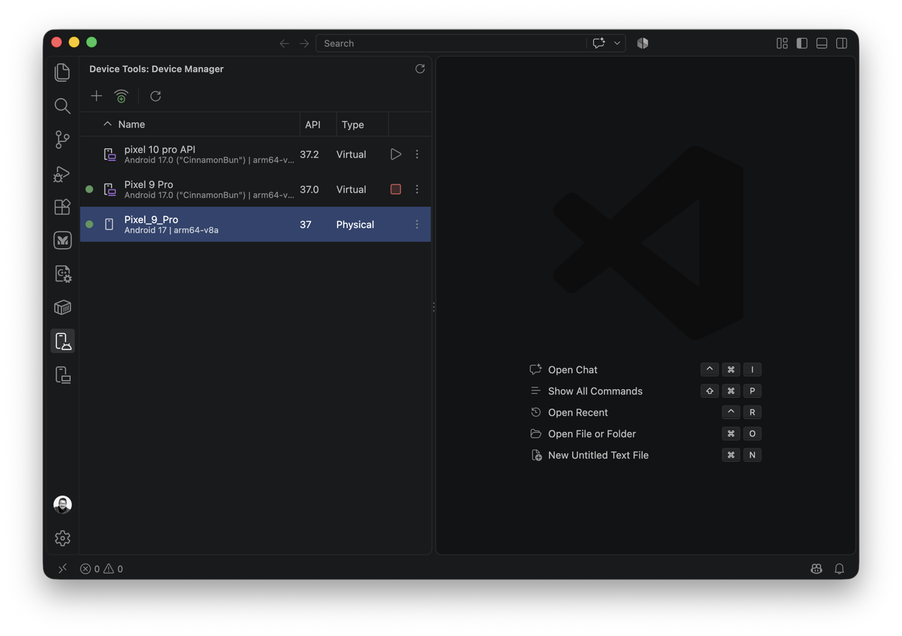
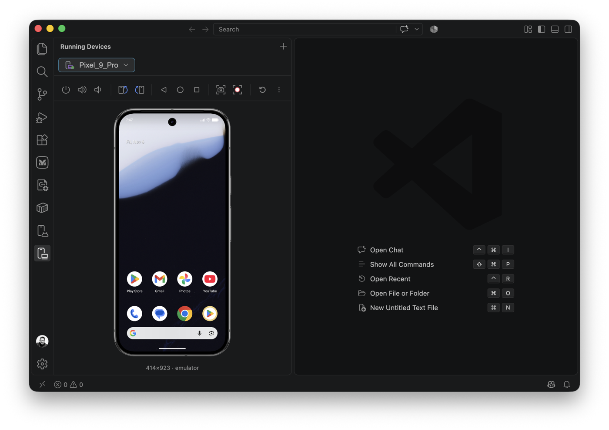
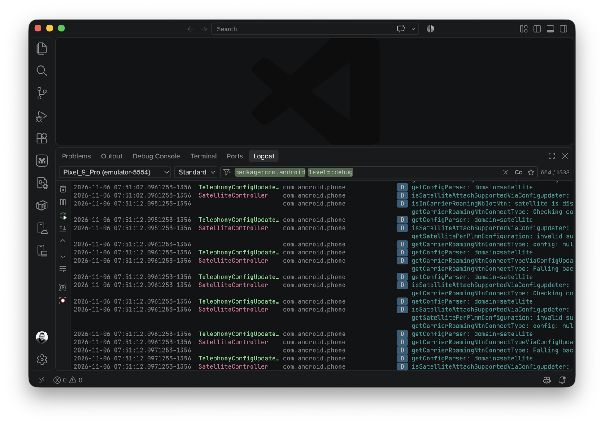

# Device Tools for Android

Device tooling for Android inside VS Code, inspired by the tools found in Android Studio: **Running Devices**, **Device Manager** and **Logcat**, without leaving your editor. Works with Flutter, Kotlin, React Native, or any project that targets Android.

> Not affiliated with Google or JetBrains. "Android" is a trademark of Google LLC.

## Features

### Running Devices

- Live screen of Android emulators and physical devices, with touch, scroll, keyboard, back/home/overview, power, volume and rotation controls.
- Emulators are streamed through the emulator gRPC API (same approach as Android Studio). Physical devices use scrcpy. A screenshot loop is the last resort.
- **Device frame (skin)** around the screen when the AVD has one, toggled from the ⋮ menu.
- Screenshot (with *Rectangular*, *Display Shape* or *Show Device Frame* when the AVD has a skin) and screen recording.
- **Extended Controls** (location, battery, cellular…) opened natively when the emulator supports it.
- `+` button to start a virtual device or pair a device over Wi-Fi.

### Device Manager

- Table of your AVDs and connected devices (name, API, type).
- Create, edit, start, cold boot, stop, wipe data and delete AVDs.
- Start/stop progress indicators, like Android Studio.

### Logcat

- Studio-like filter language: `tag:`, `package:`, `process:`, `message:`, `line:`, `level:`, `age:`, `is:crash`, `is:stacktrace`, with `=` (exact) and `~` (regex) variants, `-` negation, parentheses, `&`/`|`.
- Autocompletion of keys and values (tags and packages seen in the logs), filter history with match counts, favorites, match case.
- Standard and compact formats, soft-wrap, pause, restart, stack trace navigation, screenshot and recording buttons.

## Requirements

- VS Code 1.85 or later.
- The **Android SDK** (platform-tools, emulator, and cmdline-tools for creating AVDs). It is found through the `android.sdkPath` setting, `ANDROID_HOME`, `ANDROID_SDK_ROOT`, or the default install location.
- No other install is needed: scrcpy's server is bundled.
- Tested on macOS (Apple Silicon). Linux and Windows are expected to work but are less tested.

## Settings

| Setting | Default | Description |
|---|---|---|
| `android.sdkPath` | `""` | Android SDK path. |
| `android.embeddedEmulator` | `true` | Launch emulators without their own window (`-qt-hide-window -grpc <port>`) and show them in Running Devices. |
| `android.fixSoftwareRendering` | `true` | Before launching an AVD with `hw.gpu.enabled=no` (the `avdmanager` default, very slow), switch it to host GPU by editing its `config.ini`. |
| `android.mirrorIntervalMs` | `150` | Delay between captures in screenshot fallback mode. |
| `android.logcat.maxEntries` | `50000` | Logcat entries kept in memory. |

## What the extension changes on your machine

- Pushes `scrcpy-server` to `/data/local/tmp` on devices mirrored with scrcpy.
- Launches emulators with `-grpc <free port>`. The gRPC endpoint is local only.
- May edit `~/.android/avd/<name>.avd/config.ini` (GPU settings, see above). Disable with `android.fixSoftwareRendering`.
- Reads emulator state from the SDK's `avd/running/*.ini` files (gRPC port and token, which are required to attach to emulators started by Android Studio).
- No telemetry. No network access other than to your local emulators and `adb`.

## Troubleshooting

- **Nothing in Device Manager**: set `android.sdkPath`, then run *Device Tools: Refresh*.
- **Emulator feels slow**: make sure `android.fixSoftwareRendering` is on, or set `hw.gpu.mode=auto` in the AVD.
- **Extended Controls open in a VS Code panel instead of the native window**: the emulator must be started by this extension (`-qt-hide-window`) or support the UI controller service.
- **Physical device shows no live video**: authorize USB debugging on the device; otherwise the screenshot fallback is used.

## Credits

Icons come from Android Studio and the IntelliJ Platform (Apache-2.0); see [NOTICE](NOTICE) and [THIRD_PARTY_NOTICES.md](THIRD_PARTY_NOTICES.md). Screen mirroring of physical devices uses [scrcpy](https://github.com/Genymobile/scrcpy).

## License

[MIT](LICENSE)
